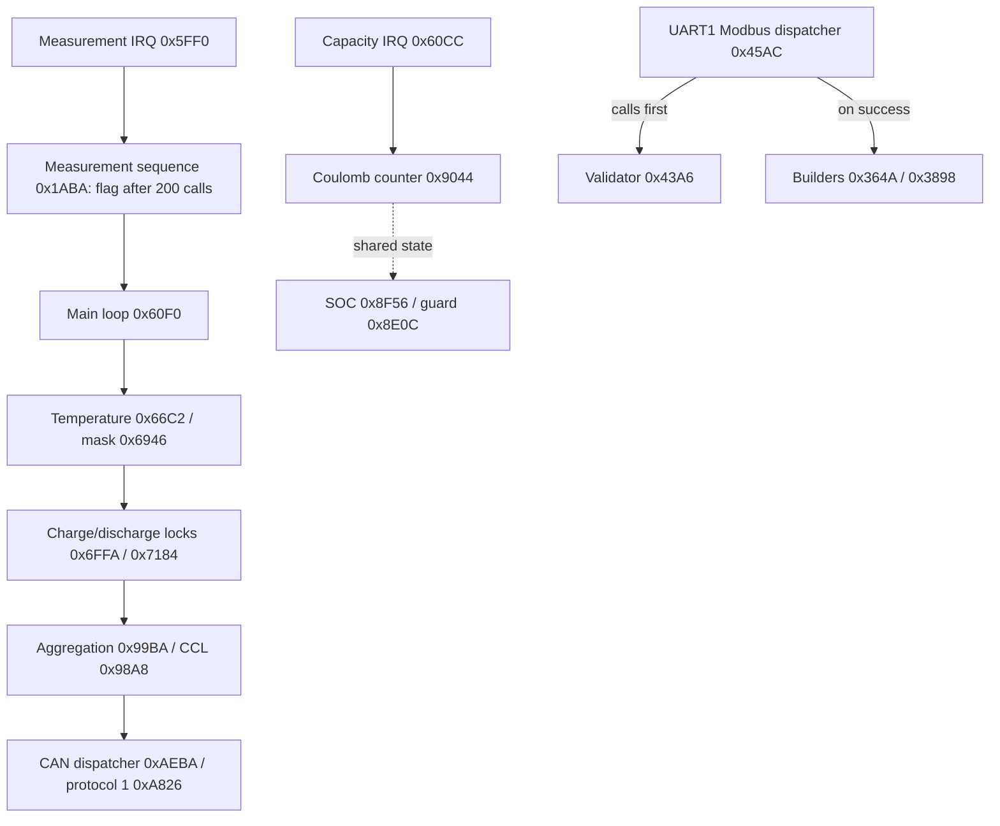

# Ghidra OEM firmware review

> **Port notation:** **UART0 = RS485-1/RS485-2 (shared pack bus)**; **UART1 = RS485 pair in the CAN socket**; **UART2 = local display/Bluetooth port**. UART1 carries RS485 traffic; the actual CAN interface uses separate pins in the same socket.

## Corpus and source identity

All seven retained OEM applications were imported with Ghidra 12.1.4,
`ARM:LE:32:Cortex`, explicit Thumb context and byte-addressed application base
0. The 16 pseudo-HEX header records are separated from the contiguous,
checksum-valid Intel HEX application. The corpus coverage figures describe
static analysis; the .13 register checks below additionally include bounded
instruction replays. No device access, flash operation or MAINT comparison
forms part of this review.

| OEM build | EHEX SHA-256 prefix | Application SHA-256 prefix | Discovered functions / C exports |
|---|---|---|---|
| 16.04.06 | `2b00410571fcb9da` | `fa38fbd4dba02eb4` | 345 / 345 |
| 16.06.03 | `246e1eca5637bcc1` | `689d3819eb9f73e1` | 345 / 345 |
| 16.06.04 | `d69f27c1650e31cf` | `390299c85aae21b1` | 350 / 350 |
| 16.06.05 SP80 | `c8f0560b7d32df30` | `a2abc282abf9d344` | 350 / 350 |
| 16.06.11 | `2dae963fd5aa11aa` | `b686b69e69878390` | 368 / 368 |
| 16.06.12 | `46d25a5f565ae014` | `f487ac4bc3b89c5f` | 368 / 368 |
| 16.06.13 | `0ea75c9834cf1978` | `5c36a7e08fb881b3` | 371 / 371 |

Totals: **2,497 function instances with C exports**, 149,595 original-bound
instructions. The prefixes navigate the [original image table](firmware-analysis.md#1-files-examined);
reuse requires the complete application hash, not just a version label or prefix.
For .13 it is
`5c36a7e08fb881b3c2ca6a22888ecb63585c3eb6811fb67b67cc9d0d0ecdde95`.
The corresponding complete EHEX hash is
`0ea75c9834cf19789a58f58db8cde1a2bbd722a8f5a7bde7f00106f59b91ccf6`.

## Instruction-bound findings

| Mechanism | Exact build / function addresses | Result and limit |
|---|---|---|
| SP80 charge block | .04/.05 function `0x6516`, instruction `0x658A` | Exactly one application byte changes: `71 24` → `73 24` (`movs r4,#0x71` → `#0x73`). Event 6 bit 1 joins the charge-block mask. This does not prove different factory settings or a measured MOSFET transition. |
| Temperature working state | .11 `0x64FA`/`0x678A`; .12 `0x64F6`/`0x677A`; .13 `0x66C2`/`0x6946` | .11 evaluates against reported event byte `0x20000032`, copies it to `0x200000BB`, then masks only the reported byte. .12/.13 evaluate against independent `0xBB` and apply BitGroup2 to it. Both .11 and .12 charge/discharge lock functions are `0x6E2E`/`0x6FB8`; .13 uses `0x6FFA`/`0x7184`, testing `0xBB & 0x0A` / `& 0xA0`. |
| SOC and persistence | .12 `0x8BA0`, `0x8CEA`, `0x8DD8`; .13 `0x8E0C`, `0x8F56`, `0x9044` | Cell plausibility 2000–4300 mV; guard capped at 60, correction rules after >30; capacity /3600, SOC in tenths, whole percent `(tenths+5)/10`. The inspected idle-save branch requires a difference >50 tenths (>5 percentage points). Seconds rely on the separate timer derivation, not the integer constants alone. |
| UART1 Modbus current/power | .13 validator `0x43A6`, dispatcher `0x45AC`, FC04 builder `0x364A` | `0x3102` remains one signed 16-bit word, 0.01 A, clamped to ±32700 using wider intermediate arithmetic. Power is the unsigned low/high pair `0x3103/04`, 0.01 W. Big-endian bytes inside each register are separate from low-word-first pair order. |
| UART1 fixed-block validation | .13 `0x43A6`, FC03 builder `0x3898` | FC03 `0x9000` compares the low count byte with 26; FC04 `0x3100` compares it with 44. High count bytes are not validated by this comparison. No malformed-request device test was made. |
| CCL and stable CAN envelope | .11 `0x9620`; .12 `0x963C`; .13 `0x98A8`; .13 protocol-1 sender `0xA826` | All seven send the same eight protocol-1 IDs with DLC 8, but .12 changes multi-pack active/passive selection and heater floor (5→10 A per configured pack). .12 is checked directly; the transition is not interpolated from .11/.13. |

The limits refer to the producer's data flow, not an independently verified
Deye receiver, physical port wiring or electrical protection test. Parameter
values and thresholds above are behavior descriptions, not recommendations.

## Architecture at OEM 16.06.13

The periodic chain describes processing order, not a direct call between
every adjacent box. The Modbus arrows are direct call relationships: dispatcher
to validator and dispatcher to selected builder. Addresses are all for .13;
do not mix them with the .11/.12 functions in the comparison table.

CCL ordering matters: the all-charge-blocked path first stores zero; heating
can raise the stored minimum; the cell-overvoltage condition can store zero
again; ordinary changes then pass through the ramp. Therefore charge-blocked
packs alone do not imply an unconditional final CCL of zero while heating is
requested. [Detailed limit order](../protocols/can.md#3-limits-and-data-source-master-aggregation-confirmed).

## Evidence and remaining limits

The retained local evidence bundle is `local/research/ghidra-oem-20261111/`:
manifest with complete EHEX/application hashes, per-image coverage, 65 selected
function exports with source-bound instructions and C, and verification data.
The bundle is a local analysis cache, not a required patch input or a replacement
for the mandatory patcher tests. OEM images remain unchanged.

Complete import and successful C generation do not establish exhaustive
function discovery or correct semantics in every output. Indirect calls,
automatically guessed library prototypes, quotient/remainder registers and
hardware types need instruction checks. The unavailable bootloader is not
recovered. Historical emulator/laboratory evidence is separate and was not
rerun here. CAN payload builders were not all semantically reverified, and no
firmware compatibility or measured safety approval follows from this review.

## SWM181 register-bound review of OEM 16.06.13

The [startup and peripheral contract](startup-clock-timers.md) binds the exact
.13 application to the retained SWM181 V2.07 manual, Cortex-M0 guide and both
SDK snapshots. REA/Ghidra 12.1.4 and REA/Hopper provide instruction checks;
17 bounded Unicorn replays execute the actual Thumb initializers without
replacement instructions or stubbed functions. They establish register writes
with synthetic immediate-readback MMIO, not real peripheral timing or full boot.

The concrete results include all six active IRQ routes/priorities, the complete
48 MHz selection, reset-mode watchdog setup and grouped progress mask, UART
dividers/timeouts, and CAN bit-timing/interrupt settings. The slow-loop backlog
counter is not a demonstrated lost-update detector. The current-limiter
handover also requires signed current `[0x20000C94] >= 1000`.

The ELF wrappers retain the application bytes exactly at base zero. Explicit
Thumb symbols seed real vector handlers; they are analyst-added discovery
metadata, not recovered OEM symbols. The older relocatable `app.elf` cache
imports at different addresses under default REA/Ghidra loading and must not
be used with raw application addresses without checking its mapping.

Decompiler output has concrete limits: Ghidra's `0xBC34` signature drops the
mode argument preserved in r2, and Hopper's `0x9A88` pseudocode omits CAN
configuration stores present in the instructions. Neither pseudocode text
alone establishes these contracts. Manual/SDK disagreements in watchdog reset
timing, reset-cause bits and UART register summaries remain explicit.

Evidence is retained under `local/research/swm181-rea-20261112/`: complete REA
bundles with Evidence IDs, original-byte bindings, wrapper construction inputs,
replay source/results and the finding ledger. The 65 selected exports in the
seven-image review were also rebound to their original applications: 5,497
instruction records and all recorded C-export hashes match. This is a fresh
identity check of those exports, not a second whole-corpus semantic review.
